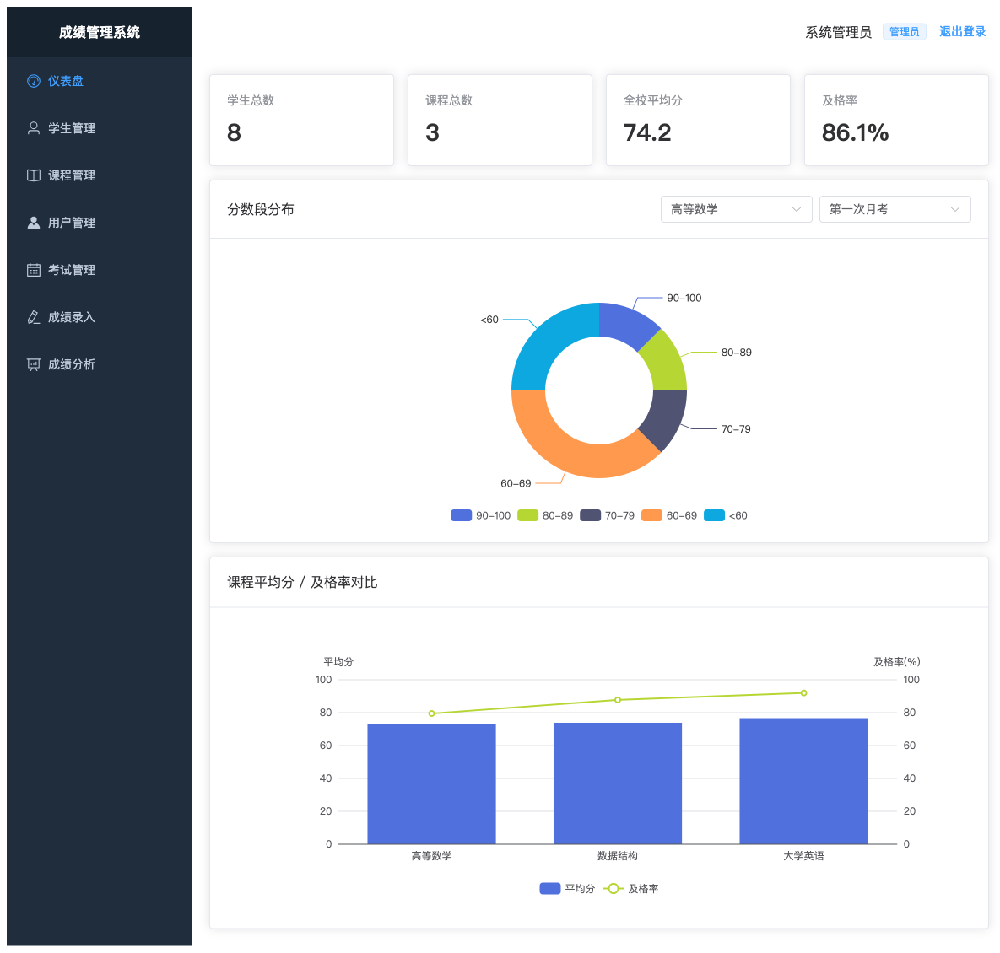
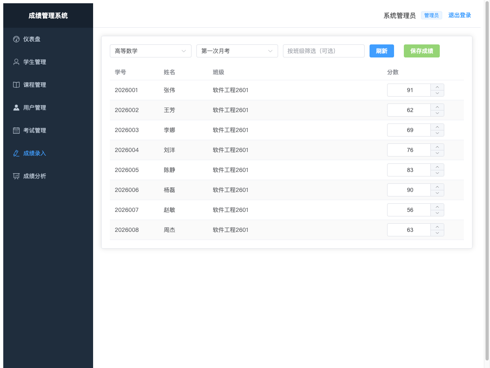
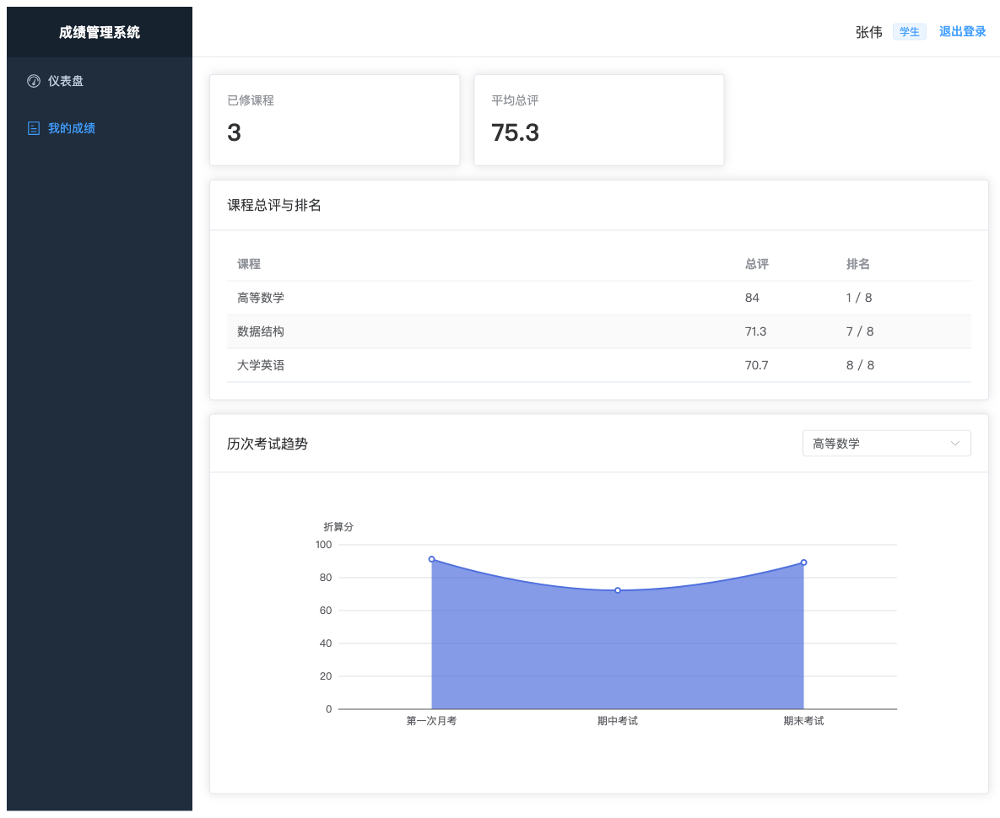

# 学生成绩管理系统

基于 Spring Boot 3 + Vue 3 的前后端分离学生成绩管理系统，支持管理员 / 教师 / 学生三种角色，
包含学生信息管理、课程与考试管理、成绩录入与多维度统计分析。

## 技术栈

- 后端：Java 17（运行环境 Java 20 验证通过）、Spring Boot 3.5.16、Spring Security + JWT（jjwt 0.12.7）、MyBatis-Plus 3.5.7、MySQL 8
- 前端：Vue 3、Vite、Element Plus、Pinia、Vue Router、ECharts
- 测试：JUnit 5 + MockMvc（H2 内存库，MODE=MySQL）、Vitest

## 功能

- 登录认证：JWT 无状态认证，三角色权限控制，账号启用/禁用、密码重置
- 学生管理：分页查询、增删改、按学号开通学生登录账号（初始密码 123456）
- 课程管理：分配任课教师，教师只能管理自己课程
- 考试管理：按课程维护多次考试（名称、日期、满分）
- 成绩管理：按考试场次录入，每名学生一行、各科成绩横向展示与批量保存，自动校验分数范围（0 ≤ 分数 ≤ 满分）
- 成绩分析：
  - 总览仪表盘（学生数、课程数、平均分、及格率）
  - 分数段分布（90-100 / 80-89 / 70-79 / 60-69 / <60）
  - 个人历次考试趋势
  - 课程平均分与及格率对比
  - 不及格预警（阈值可调）
- 学生端：查看本人课程总评、排名与趋势

## 快速开始

### 1. 环境要求

- JDK 17+（本项目在 Java 20 下运行）
- Node.js 18+
- MySQL 8

### 2. 初始化数据库

只需要安装并启动 MySQL，**不需要手动建库建表**：

```bash
brew install mysql
brew services start mysql
```

如果 MySQL root 有密码，修改 `backend/src/main/resources/application.yml` 中的 `username` / `password`。

应用启动时 `DatabaseBootstrap` 会连接 MySQL 服务端（不指定库）检查状态：

- **`score_db` 不存在** → 自动创建数据库，建表并写入演示数据；
- **`score_db` 存在但没有核心表**（如手动建的空库）→ 只建表并写入演示数据；
- **`score_db` 已存在且已有 `sys_user` 表** → 完全跳过建表与演示数据初始化，启动日志输出"已存在且已完成初始化，跳过初始化"。

因此重复启动不会重复建表或插入演示数据。

> Homebrew 安装的 MySQL 8.4 若 `mysql` 命令不在 PATH 中，用完整路径
> `/usr/local/opt/mysql@8.4/bin/mysql -uroot ...`，或 `export PATH="/usr/local/opt/mysql@8.4/bin:$PATH"`。

### 3. 启动后端

```bash
cd backend
./mvnw spring-boot:run
```

后端运行在 <http://localhost:8080>。首次启动会自动写入演示数据。

### 4. 启动前端

```bash
cd frontend
npm install
npm run dev
```

访问 <http://localhost:5173>。

## 界面预览

| 管理员仪表盘 | 成绩分析 |
| --- | --- |
|  |  |

| 成绩录入 | 学生端「我的成绩」 |
| --- | --- |
|  |  |

## 演示账号

| 角色 | 用户名 | 密码 |
| --- | --- | --- |
| 管理员 | admin | 123456 |
| 教师 | teacher1（张老师，高等数学/数据结构） | 123456 |
| 教师 | teacher2（李老师，大学英语） | 123456 |
| 学生 | 2026001 ~ 2026008 | 123456 |

## 测试

```bash
cd backend && ./mvnw test          # 49 个集成/单元测试，使用 H2，不依赖 MySQL
cd frontend && npm test            # Vitest 单元测试
cd frontend && npm run build       # 构建校验
```

## 目录结构

```
backend/    Spring Boot 服务（controller / service / mapper / security）
frontend/   Vue 3 前端（views / api / stores / router）
docs/       设计文档与实现计划
```

## 主要接口

| 方法 | 路径 | 说明 |
| --- | --- | --- |
| POST | /api/auth/login | 登录获取 JWT |
| GET | /api/auth/me | 当前登录人信息 |
| GET | /api/students | 学生分页查询 |
| POST | /api/students/{id}/account | 开通学生账号 |
| GET/POST/PUT/DELETE | /api/courses | 课程管理 |
| GET/POST/PUT/DELETE | /api/exams | 考试管理 |
| GET | /api/scores?examId= | 考试名单与成绩 |
| POST | /api/scores/batch | 批量录入成绩（存在则更新） |
| GET | /api/scores/my | 学生查看本人成绩与排名 |
| GET | /api/analysis/overview | 总览统计 |
| GET | /api/analysis/distribution | 分数段分布 |
| GET | /api/analysis/trend | 个人成绩趋势 |
| GET | /api/analysis/course-comparison | 课程对比 |
| GET | /api/analysis/failing | 不及格预警 |
| GET/POST/PUT | /api/users | 教师账号管理（管理员） |

## 权限说明

- `ADMIN`：全部功能。
- `TEACHER`：只能操作自己任教课程下的考试与成绩，只能查看自己课程的分析数据。
- `STUDENT`：只能查看自己的成绩、排名与趋势。
- 数据归属校验在 Service 层完成，绕过前端直接调用接口同样会被拦截（403）。

## 已知取舍

- JWT 无状态，注销后 token 在过期前仍有效（课程项目可接受）。
- 未引入选课表，成绩录入按全部学生名单展开（可按班级筛选）。
- 前端构建对 Element Plus + ECharts 产生较大 chunk，生产环境可进一步做按需引入与代码分割。
